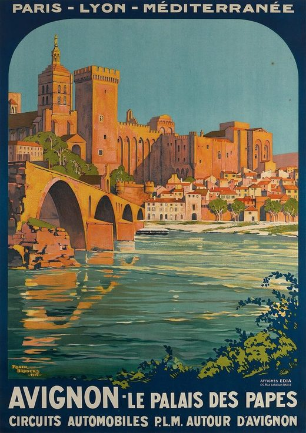
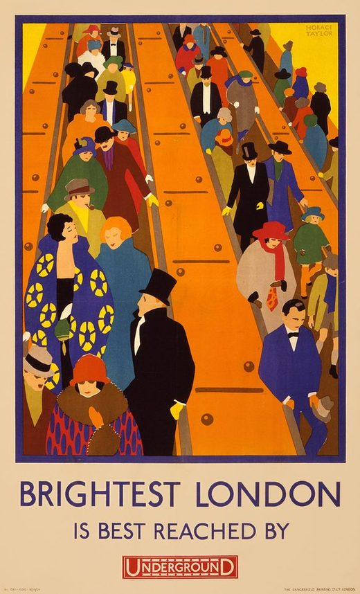
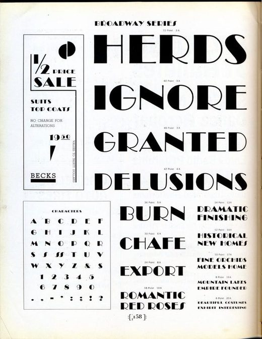
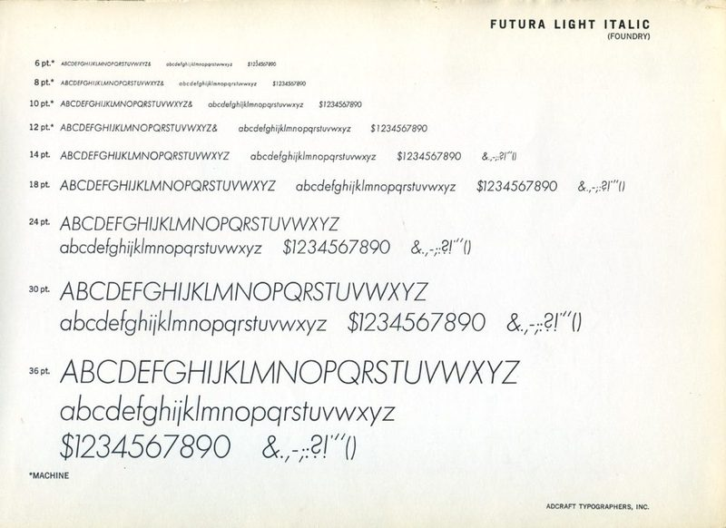
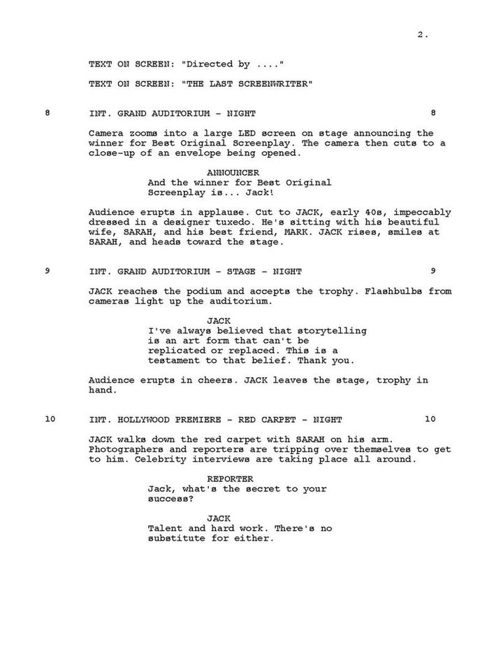
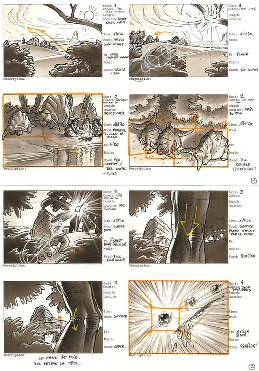
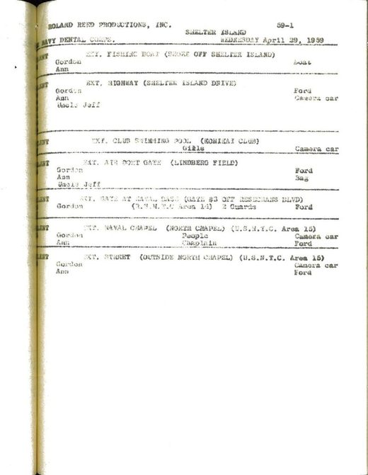
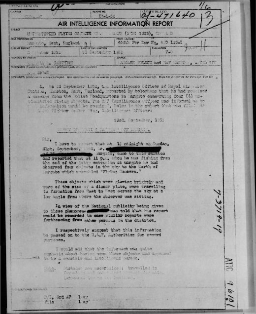

# Design document for LMML

This is the design document for the LMML project for the course Information Modeling and Web Technologies. Made by Bram Mathijsen.

## 1. Technical choices

The main architecture of the application consists of a front-end back-end architecture. This is chosen deliberately so the application is modular; the front-end can connect to a different back-end and vice versa. The implementation of the API should be seen as a simulation. The whole application is a static website, so it can run on GitHub Pages without a server: the back-end code runs in the browser of the visitor. The API is not deployed on a server and is deliberately kept away from third-party techniques that could deploy it. However in the future this is certainly possible, and only the “apiClient.js” file would have to change.

The back-end has a database, called “db.json”. In this file all the (meta)data necessary for the content is stored. The data is stored only once: records point to each other by id, and “api.js” joins them before they are sent. Where possible the metadata follows existing standards, such as schema.org for the places and productions and CSL-JSON for the references. The back-end also has an “api.js” file. In this file the API endpoints for delivering the back-end data to the front-end are located, such as /locations/old-bailey.

The front-end has an “apiClient.js” file that creates the requests that get sent to the back-end, so the front-end can retrieve the necessary data from the database. This data then gets loaded into the HTML files. Every HTML file holds the structure of its own page, with a small, fixed set of HTML elements. Classes and data-* attributes mark the parts of the page, so a theme can style them without changing the HTML.

The application uses different external libraries. Leaflet was used for rendering the map, with the live position of the visitor on it. Leaflet is an open-source, highly customizable and easy to use map library. qrcode-generator was used to generate the QR codes. Lastly a translator, translate.js, was used so the requirement for texts in different languages could be fulfilled. This was chosen over hard-coded multilingual text in the db.json file, so multiple languages could be easily supported. English is the default, and a page is only translated when the visitor chooses another language. All three libraries are open source and stored in the project itself.

## 2. Media choices

For this project four films and series were chosen: Amélie and Emily in Paris for Paris, and Love Actually and Sherlock for London. In total there are 32 locations: 17 in Paris and 15 in London. For every film or series different types of media are selected: texts, videos and photos.

The descriptions of the different scenes and paths are implemented as per the requirements: long text, medium text, short text and different text difficulty options, for three audiences (young visitors, adults and scholars). The user can press different buttons to expand or change the text; this will be described in more detail in chapter three.

The images consist of freely licensed real-life photos from Wikimedia Commons connected to a specific scene, and stills from the films and series directly retrieved from fan and screenshot sites. Every photo is credited with its creator and licence. The stills are copyrighted, so they are kept small (at most 960 pixels wide) and credited to their rights holders. These files are saved locally, so the images keep being visible even if the third-party site shuts down. In the database the URLs to the local files are stored for the front-end to load in.

The videos are clips from YouTube, to bring the experience more to life. Only clips from official or licensed channels were used. The links to the clips are stored in the database so the front-end can load them in, and a clip only loads when the visitor presses play.

## 3. Design choices

The web application has different general design choices and two themes. The pictures in 3.2 and 3.3 are real publications that the typography of the themes is based on. They come from Wikimedia Commons, so are free to use.

### 3.1 General

For the general design the golden ratio (about 1.618) has been used on every page: the biggest panel is 1.618 times as wide as the other panels. On the story pages the three main panels are divided in three parts, where the right part is the biggest. In Affiche this part has the map, because the map needs to be clearly visible; in Script it has the list of stops. On the location pages the biggest panel is on the left: the pictures in Affiche and the text in Script.

Every page is exactly as big as the screen. Only the panels scroll, each on its own. On a portrait screen, such as a phone, the panels are shown one at a time, with tabs to switch between them.

Every location has nine texts: a short, a medium and a long text for each of the three audiences, and every text has three levels of difficulty. The visitor changes the text with six buttons, such as “Tell me more” and “This text is too difficult”. All the texts are already in the page, so a button only changes which one is shown. Every location also has a button with "navigate" that opens the google maps app for mobile users.

### 3.2 Theme 1: Affiche

For theme one a general and very classic theme called “Affiche” was chosen, after the travel posters of the 1920s–30s (Cassandre, the London Underground). This was done so the current movies, and most importantly movies added in the future, have a theme that fits in the general sense. That is why Affiche is the default theme for the two stories that combine several productions, Two Parisiennes and Shot for shot. The pictures lead, with flat colours per city, the route as a railway line and the record as a timetable. The fonts used were:

1. Limelight (titles): an Art Deco display face from 2011, in the lettering style of 1920s–30s travel posters. Its hairline-thin strokes disappear at small sizes, so it appears only in titles.
2. Jost (normal text): a geometric sans inspired by the German sans-serifs of the 1920s, such as Futura (1927). It's the reading face of the poster era and stays clear on a phone outdoors.

*From left to right: travel posters by Roger Broders (Avignon, for the PLM railway, 1922) and Horace Taylor (Brightest London, for the London Underground, 1924), and specimens of Broadway (late 1920s) and Futura (1927). The posters show the large titles, the small capitals and the city colours of Affiche; Broadway shows the Art Deco letters that Limelight follows, and Futura the sans-serif that Jost follows.*

*Sources, all on Wikimedia Commons (resized): [Broders](https://commons.wikimedia.org/wiki/File:Roger_Broders_Avignon_Le_palais_des_papes_1922.jpg) and [Taylor](https://commons.wikimedia.org/wiki/File:Brightest_London_is_best_reached_by_Underground,_subway_poster,_1924.jpg), public domain; [Broadway](https://commons.wikimedia.org/wiki/File:Broadway_Series.jpg) and [Futura](https://commons.wikimedia.org/wiki/File:Futura_Light_Italic_%287242027916%29.jpg), photos by James Puckett, [CC BY 2.0](https://creativecommons.org/licenses/by/2.0).*

### 3.3 Theme 2: Script

The second theme is called “Script”, after the screenplay page and the paperwork of a film shoot. This theme is used for the story Amélie, scene by scene. It has the slightly quirky and unserious “movie” feel that Amélie has. The theme can also be used for a detective movie, because it has a “newspaper-esque” feel. That's why the theme is also the default theme for the Sherlock story, The game is on. Each stop opens with a scene heading, like EXT. RUE LEPIC – DAY, the pictures are storyboard frames and the route is a stripboard. In the different "chapers" for the story, the header is a different colour, so the chapters are clearly visually recognizable. The font used is Courier Prime: a version of Courier drawn for screenplays in 2013, because scripts are traditionally typed in 12-point Courier. It keeps Courier's letter widths but adds real italics and a stronger bold, at a single size like a typewriter.

*Left to right: a page of the screenplay of The Last Screenwriter (2024), a storyboard for the game Ryzom, the schedule of one shooting day of The Navy Dental Corps (US Navy, 1959) and a typed police report in a case file of Project Blue Book (US Air Force, 1952). The screenplay is set in Courier at one size, and every scene heading is in capitals with its number in both margins, like the stops in Script. The numbered frames of the storyboard are the model for the pictures, the rows of the schedule for the stripboard, and the typed report for the detective feel.*

*Sources, all on Wikimedia Commons (resized): the [screenplay](https://commons.wikimedia.org/w/index.php?title=File:The_Last_Screenwriter_-_Screenplay.pdf&page=3), the [schedule](https://commons.wikimedia.org/w/index.php?title=File:%27The_Navy_Dental_Corps%27_Screenplay_Shooting_Script_%28IA_NavyDentalCorpsScreenplayShootingScript%29.pdf&page=45) and the [report](https://commons.wikimedia.org/w/index.php?title=File:Project_Blue_Book_report_-_1952-09-6384162-Kent-England.pdf&page=2), public domain; the [storyboard](https://commons.wikimedia.org/wiki/File:Ryzom_storyboard_1.jpg) by Ryzom, [CC BY-SA 2.0](https://creativecommons.org/licenses/by-sa/2.0).*

### 3.4 Stories

A story decides which locations appear and in which order, the directions between them, how to recognise each stop, the introduction of every chapter, the narration, the pictures and the text the visitor starts with. It also decides the theme. Choosing a story applies all of this at once.

There are four stories. Two Parisiennes is the class trip of Alice, a teacher, with texts for young visitors; it uses Affiche. Amélie, scene by scene follows the film through Paris and uses Script. Shot for shot is the London tour of Bruno and Beatrix, with the camera positions and costume notes they need to recreate the shots; it uses Affiche. The game is on is a Sherlock trail for children and uses Script. So a story about one film or series uses Script, and a story that combines several productions uses the general theme, Affiche.

A location page follows the story the visitor is following. That way a scanned QR code opens the location as a stop of that story.
